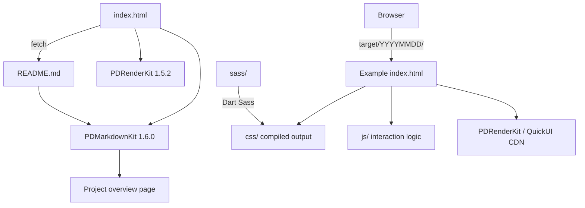

# Project Structure

This page covers the repo layout and the naming convention for example folders.

## Layout

| Path | Content |
|------|---------|
| `index.html` | Landing page: initialized with PDRenderKit, renders `README.md` with PDMarkdownKit 1.6.0 |
| `README.md` | Landing page content: project overview, features and architecture |
| `target/<YYYYMMDD>/` | One example; the folder name is its creation date |
| `image/<YYYYMMDD>.jpg` | Example preview screenshot, named after the folder |
| `image/website.jpg` | Landing page Open Graph image |
| `css/index.css` | Landing page styles |
| `sitemap.xml` | URLs for the landing page and 37 examples (all except `20230313`) under `https://pardn.io/web-template` |
| `.gitattributes` | Marks `.md` / `.scss` / `.css` as documentation so GitHub language statistics count only `.html` and `.js` |

## Example Folder Contents

| Path | Description |
|------|-------------|
| `index.html` | Example entry; some examples ship several HTML files (e.g. `login.html`, `search.html` in `20240625`) |
| `view/`, `views/` | HTML fragments loaded dynamically by the framework (e.g. `20230616`, `20230719`) |
| `css/` | Compiled SCSS output, the file `index.html` actually loads |
| `sass/` | Style sources: an entry file plus `_*.scss` partials |
| `js/` | Example interaction logic and sample data (29 examples) |
| `image/` | The example's own assets (20 examples) |

Large template catalogs such as TemplateMo (620+ HTML CSS templates, pure CSS and Bootstrap layouts), HTML5 UP (responsive HTML5 and CSS3 site templates), Start Bootstrap (Bootstrap 5 themes and templates) and learning-zone/website-templates (150+ HTML5 templates on GitHub) ship finished downloads. demo-web is smaller and built for study: 38 date-named examples, none using Bootstrap, each folder keeping its `sass/` sources next to the compiled `css/` it loads, and 32 of them showing PDRenderKit or QuickUI in real pages.

## Landing Page and Examples

The landing page and the examples are independent: `index.html` only renders `README.md`, and each example is opened directly by its folder URL.

## Related

- [Styling Workflow](/styling-workflow)
- [Frameworks](/frameworks)
