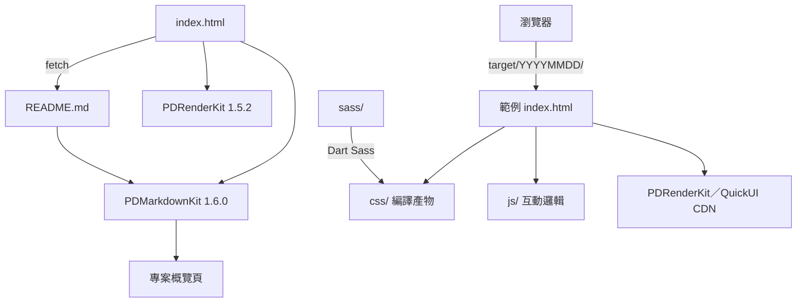

# 專案結構

本頁說明 repo 的目錄配置與範例資料夾的命名規則。

## 目錄配置

| 路徑 | 內容 |
|------|------|
| `index.html` | 首頁：以 PDRenderKit 初始化、PDMarkdownKit 1.6.0 渲染 `README.md` |
| `README.md` | 首頁內容來源：專案概覽、功能與架構 |
| `target/<YYYYMMDD>/` | 單一範例，資料夾名即製作日期 |
| `image/<YYYYMMDD>.jpg` | 範例預覽截圖，與資料夾同名 |
| `image/website.jpg` | 首頁 Open Graph 圖片 |
| `css/index.css` | 首頁樣式 |
| `sitemap.xml` | 首頁與 37 個範例（`20230313` 以外）的 URL 清單，網址位於 `https://pardn.io/web-template` |
| `.gitattributes` | 將 `.md`／`.scss`／`.css` 標為文件，GitHub 語言統計只計 `.html` 與 `.js` |

## 範例資料夾組成

| 路徑 | 說明 |
|------|------|
| `index.html` | 範例入口；部分範例另含多個 HTML（如 `20240625` 的 `login.html`、`search.html`） |
| `view/`、`views/` | 以框架動態載入的 HTML 片段（如 `20230616`、`20230719`） |
| `css/` | SCSS 編譯產物，`index.html` 實際載入的檔案 |
| `sass/` | 樣式原始碼，入口檔加上 `_*.scss` partial |
| `js/` | 範例互動邏輯與範例資料（29 個範例） |
| `image/` | 範例自身素材（20 個範例） |

TemplateMo（620+ 款 HTML CSS 模板，純 CSS 與 Bootstrap 版型）、HTML5 UP（響應式 HTML5／CSS3 網站模板）、Start Bootstrap（Bootstrap 5 主題與模板）與 learning-zone/website-templates（GitHub 上 150+ 款 HTML5 模板）這類大型模板庫提供的是可直接下載的成品。demo-web 規模較小、以觀摩為目的：38 個以日期命名的範例都不使用 Bootstrap，每個資料夾的 `sass/` 原始碼與實際載入的 `css/` 編譯產物並存，其中 32 個範例示範 PDRenderKit 或 QuickUI 在實際頁面中的用法。

## 首頁與範例的關係

首頁與範例彼此獨立：`index.html` 只渲染 `README.md`，每個範例直接以資料夾網址開啟。

## 相關頁面

- [樣式工作流程](/zh/styling-workflow)
- [框架使用](/zh/frameworks)
